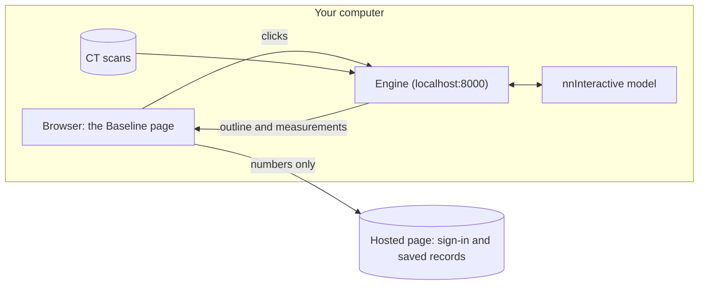

<p align="center">
  <picture>
    <source media="(prefers-color-scheme: dark)" srcset="docs/logo-lockup-dark.svg">
    
  </picture>
</p>

<h3 align="center">Lung nodule measurement on CT, a research aid</h3>

<p align="center">Outline and measure a lung nodule on CT in one click, then correct it with a few more.</p>

<p align="center">
  <a href="https://github.com/hillel-base/baseline/actions/workflows/windows-setup.yml"></a>
  <a href="LICENSE"></a>
</p>

> **Research use only. Not a medical device.** Baseline does not diagnose, and its measurements are not for clinical decisions.

## Quick start

**macOS or Linux** (Terminal):

```bash
curl -fsSL https://raw.githubusercontent.com/hillel-base/baseline/main/install.sh | bash
```

**Windows** (PowerShell):

```powershell
irm https://raw.githubusercontent.com/hillel-base/baseline/main/install.ps1 | iex
```

The command:
1. Gets the code into `~/Baseline` (`%USERPROFILE%\Baseline` on Windows), with git if you have it, or as a download.
2. Installs uv and Python 3.11 if they are missing.
3. Gets the page for your own computer: it builds it with Node 22.12 or newer, or downloads it from this version's release.
4. Installs the engine's packages, and on macOS and Linux the [nodule finder](#nodule-finder-optional)'s packages.
5. Downloads the model weights (392 MB) from their publisher.
6. Downloads 8 public practice patients (about 2.1 GB) from NCI Imaging Data Commons. For all 28, see [More practice patients](#more-practice-patients).
7. Starts the engine on `http://localhost:8000`.
8. Opens the page:
   - **Mac with Chrome:** the Baseline page, in Chrome. It connects to the engine on your computer by itself.
   - **Mac without Chrome:** the page on your own computer, `http://localhost:8000`, in your default browser. Safari can use it (see [Safari](#troubleshooting)).
   - **Linux and Windows:** the Baseline page, in your default browser. It connects to the engine on your computer by itself.

On a Mac with Apple silicon (M4 Pro), the first run took about 7 minutes from the command to a running engine (6 min 44 s in a clean install; the nodule finder took 18 s of it and the 8 practice patients about 4 minutes; the finder's load check, added after that install, adds about 27 s). It downloaded about 3.5 GB and used about 4.8 GB of disk. Run the same command again to update the code and start the tool: steps already done are skipped, and the engine was running again in about 10 s. Stop the engine with Ctrl+C, or close the window.

Then:
1. **Sign in** (the Baseline page only). It is invite-only. Without an invitation, open `http://localhost:8000` instead: the page on your own computer needs no sign-in.
2. **Pick a scan** in the **Patients** panel (the button in the top bar): the patients and their scans by date. To add your own scans, click **Change folder…** in the panel and choose the folder that holds them (DICOM).
3. **Click the nodule.** The outline appears, with its long axis (magenta), its short axis (cyan) and its volume.
4. **Correct the outline:** an **Add** click where it misses, a **Remove** click where it spills over, or Paint and Erase by hand.
5. **Record.** The numbers go to your table. Copy the row, or download the table as CSV. On the Baseline page they are also saved to the **Study table**.

Each control shows its keyboard key. Press **?** to list them all. While the page says "Loading image …", wait: a click counts once that image shows.

### More practice patients

The first run gets 8 of the 28 public practice patients: the 3 development patients, with their expert outlines (RIDER-LungCT-Seg), and 5 more (CT only), so that the 8 hold small, medium and large tumours. For all 28, the same patients as on the practice server, run this in the Baseline folder, then start the tool again:

```bash
./lung.sh fetch --all      # Windows: .\lung.ps1 fetch --all
```

It downloads the other 20 patients (CT only, about 5.1 GB; about 10 minutes on our Mac). Patients already there are skipped.

## No install: the practice server

If you have an invitation to the Baseline page, choose **Practice server** in Measure. The engine then runs on our server, which has a graphics card, so you install nothing.
- **Scans:** the 28 public practice patients only.
- **One person at a time:** others see a short wait message.
- **Sometimes paused:** the page then says so and names the next step: the Demo (recorded results that need no engine) to try the tool, or your own computer for your own scans.
- **Sleeping:** a server that has not been used for a while sleeps. The page shows it as starting, and it is ready in about 1 minute.
- **Change:** the top line names where the tool runs ("Practice server · Change" or "Your own computer · Change"). **Change** goes back to the choice. If an outline is not recorded yet, the page asks first. Leaving the practice server frees it for the next person at once.

## Requirements and speed

| Computer | Time per click | Memory | Notes |
|---|---|---|---|
| Mac with Apple silicon | about 1–2 s (1.2 s on an M4 Pro) | 16 GB or more (one click peaks at about 10 GB) | uses the Mac's graphics chip |
| PC with an NVIDIA graphics card | about 0.4 s on an NVIDIA T4; other cards not measured | | uses CUDA |
| Standard PC without a graphics card (Intel or AMD) | about 20 s (32 s on a 2-core cloud machine) | 16 GB recommended (one click peaks at about 6–7 GB) | |
| Practice server | about 0.4 s (an NVIDIA T4); the first click after the server starts takes about 4 s | nothing on your computer | practically the same outlines as on a Mac (overlap 0.997 or more on 113 outlines) |

- **Disk:** about 8 GB free on macOS, 7 GB on Windows, about 14 GB on Linux; about 5 GB more for all 28 practice patients. On Linux the default PyTorch build includes the NVIDIA libraries, even without a graphics card (about 3 GB more to download).
- **Browser:** Chrome or Firefox for the Baseline page. Chrome asks you once whether the page may connect to apps on your device: choose **Allow**. Any browser, Safari too, for the page on your own computer (`http://localhost:8000`). Safari cannot use the Baseline page with your own engine, see [Troubleshooting](#troubleshooting).
- **Internet:** needed for the first run.
- **Not supported:** a Mac with Apple silicon whose graphics chip PyTorch cannot use is refused.

## How it works



- **The page:** a hosted copy runs at https://lung-measure.base44.app (on Base44, which also handles sign-in and keeps the saved records). The engine also serves the page itself, at `http://localhost:8000`: Measure only, with no sign-in, and nothing is saved to Base44.
- **The engine:** a small Python server on your own computer. It reads the scans and runs the outline model, [nnInteractive](https://github.com/MIC-DKFZ/nnInteractive) (DKFZ).
- **One click** starts a 3D outline. Each correction click updates it. The engine then measures the outline:
  - the long axis, the longest line across it on the slice where that line is longest;
  - the short axis, the longest line at right angles to it;
  - the volume and the depth.

  Widths are measured edge to edge, like a ruler.

## Privacy

- **The scans never leave your computer.** The engine reads them locally, and the page shows them straight from the engine.
- **The hosted page saves numbers and short labels only.** For example: long axis, short axis, volume, number of clicks, and a random code for each scan. Base44 never receives images, names, study dates, DICOM UIDs or folder paths.
- **Patient names and dates stay on your computer.** The page on your computer (`http://localhost:8000`) shows them. On the hosted page they show only inside the Patients panel, which the engine on your computer draws in a frame (Chrome and Firefox). The hosted page cannot read that frame and gets a random code for each scan instead; only the 28 public practice patients keep their public names.
- **The engine answers only the Baseline page's own address.** A page on another site cannot use it. Folders can be chosen only in the Patients panel that the engine draws.

## Nodule finder (optional)

Research use only. Its marks are suggestions to check, not findings: read the whole scan as usual.

- **What it is:** a separate program in `finder/` (Chou et al. 2.5D YOLO11n, on the CPU). The engine starts it for each request and reads its answer; the engine never loads its code.
- **On by default on macOS and Linux:** setup installs the finder's own packages, PyTorch included, into `finder/.venv` (`uv sync --directory finder`; on our Mac 18 s and about 0.2 GB to download, because it shares PyTorch with the engine). Then it checks that they load (about 27 s the first time, then about 1 s). `./lung.sh start` turns the finder on only after that check has passed. If the install or the check fails, setup says so, once more after "Tool is running", and goes on: the tool works without the finder, and the next `./lung.sh setup` tries again. The usual causes are no internet or a full disk, and on Linux a missing system library such as libxcb or libGL (on Debian and Ubuntu: `sudo apt install libxcb1 libx11-6 libxext6 libsm6 libice6 libgl1 libglib2.0-0`). The weights (5.5 MB) download into `~/.lung-finder/` the first time you press **Find nodules**. To turn it off: `LUNG_COPILOT=off ./lung.sh start` (or `LUNG_FINDER= ./lung.sh start`); the page then shows no finder.
- **Windows:** off. The engine stops a finder run with process calls that only macOS and Linux have, and setup says so once.
- **What it shows:** a **Find nodules** button over the image. After about 10 s, a list of suggestions, numbered like the dashed rings on the image and the ticks on the slice bar. For each one: **Go to it**, **Measure** (starts an outline there, as a first click would) and **Not a nodule**. Measure is off while an outline that is not recorded yet is open, so it never drops one.
- **How accurate:** it found about 7 in 10 of the nodules that at least 3 of 4 radiologists marked on 50 public screening CTs, with about 2 extra marks per scan. It can miss large tumours: on public lung-cancer scans it found 10 of 15 tumours of 40 mm and over.
- **Licence:** the finder is under **AGPL-3.0**, because it uses Ultralytics. The rest of Baseline is MIT and calls it as a separate process. `finder/LICENSE` has the full text and `finder/NOTICE.md` the credits. If you run it on a server for other people, show them a visible link to the exact source it runs.
- **Privacy:** it runs with `YOLO_OFFLINE=1`, so it sends no usage data. It goes online only to download its weights.
- **Speed and memory:** about 7 to 8 s per scan on a 12-core Mac (CPU only), plus about 80 s for the download on the first run; about 2 to 2.5 GB of memory while it runs.

## Results

How much hands-on time the tool saves, and how close its outlines come to the experts', is in [results/](results/README.md): the results, the protocol, the scripts and the run tables. Times there are against the lab's reported manual times, and the main figure uses modelled corrections, a lower bound on the tool's time.

## Known limits

- **Reach:** an outline reaches at most about 50 mm from the click (80 voxels at 0.625 mm pixels). The page warns when an outline touches that edge.
- **Spiculated nodules** (nodules with spikes at the edge): the first outline takes the solid core and leaves the spikes out.
  - This was tested on 10 public nodules rated "marked" by radiologists (LIDC-annot-NLST501). The first outline was about a third smaller than the radiologists' consensus.
  - Up to 5 corrections brought 9 of the 10 within the radiologists' own disagreement.
- **Follow-up scans:** matching a nodule on a follow-up scan was tested on same-day scan pairs. Real follow-ups months apart, with several nodules, will be less accurate. The match is a proposal that you confirm.
- **Touching structures:** on a tumour that touches another structure, the outline can run along it. Check the outline and correct it.
- **Nodule finder** (optional): it finds about 7 in 10 nodules and can miss large tumours. See [Nodule finder (optional)](#nodule-finder-optional).

## Troubleshooting

- **Chrome asks whether the page may connect to apps on this device.** Choose **Allow**. If you chose Block, click the icon left of the address, open the site settings, and allow it.
- **Safari:** the Base44 page cannot reach the engine on your computer (Safari blocks it). In Safari the page says so, and "Your own computer" cannot be chosen there. Use Chrome or Firefox, open http://localhost:8000, or use the practice server.
- **"You are signed in, but this app is invite-only. Ask the app's admin for an invite."** You need an invitation for the hosted page. Open `http://localhost:8000` instead: it needs no sign-in.
- **"Could not download the local page."** Setup says so and goes on: the hosted page still works. Run the command again later, or install Node 22.12 or newer, which builds the page instead.
- **The first run is slow.** It downloads about 3.5 GB on a Mac: about 0.4 GB of Python packages, 0.2 GB for the nodule finder, 0.4 GB of model weights and 2.1 GB of practice scans. Linux downloads about 3 GB more for PyTorch. Later starts download nothing.
- **"The engine stopped."** The engine stops itself when it would use too much memory (the log says `watchdog: memory … exiting`). Close other programs and run the command again. On an 8 GB PC you can raise the limit with `LUNG_MEM_LIMIT_GB=7`, at your own risk.
- **Port 8000 is in use.** The hosted page looks for the engine on port 8000 only. Stop the other program, or use the page on your own computer with `LUNG_PORT` set to another port.
- **Windows warns about a script.** Windows SmartScreen should not appear: the command runs in PowerShell and opens no downloaded file from Explorer. The install runs on GitHub's Windows machines on every change (the windows-setup check above); a person has not yet run it on a Windows PC. If you run a downloaded `install.ps1` or `Start lung tool.bat` instead and "Windows protected your PC" appears, choose More info, then Run anyway.

## Run from source

```bash
git clone https://github.com/hillel-base/baseline && cd baseline
./lung.sh setup          # macOS, Linux. Windows: .\lung.ps1 setup
```

- `setup` installs what is missing and starts the engine. Each step is skipped when it is already done. Later starts: `./lung.sh start` (`.\lung.ps1 start`).
- **Double-click to start:** `Start lung tool.command` on a Mac, `Start lung tool.bat` on Windows.
- **The page on your own computer:** with Node 22.12 or newer, `setup` builds it; without Node, it downloads the built page (`baseline-page.zip`) from this version's release. The engine serves it at `http://localhost:8000`, with no sign-in. `scripts/build-page.sh` makes that file, and a pushed tag `v<VERSION>` publishes it (`.github/workflows/release-page.yml`).
- **Settings** (environment variables):

| Variable | What it sets | Default |
|---|---|---|
| `LUNG_PORT` | the engine's port | `8000` |
| `LUNG_DATA_DIR` | the folder of practice scans | `data/rider` |
| `LUNG_BROWSE_ROOT` | the only folder tree "Change folder…" can browse | your home folder |
| `LUNG_STUDY_DIR` | the study folder the Patients panel lists, instead of "Change folder…" | |
| `LUNG_FINDER` | `subprocess`: use the nodule finder in `finder/` (see [Nodule finder](#nodule-finder-optional)) | `subprocess` on macOS and Linux once setup has installed and checked the finder; off on Windows |
| `LUNG_COPILOT` | `off`: no nodule finder, and the page shows none of it | on |
| `LUNG_NO_OPEN` | `1`: do not open the browser | |
| `LUNG_PAGE_URL` | the page to open | per system, see [Quick start](#quick-start) |
| `BASELINE_PAGE_URL` | where setup downloads the built page when Node is missing | this version's release |
| `LUNG_WIDTH` | `edge` (edge to edge) or `centre` (pixel centre to centre) | `edge` |
| `LUNG_MEM_LIMIT_GB` | the engine's memory limit | the smaller of 14 and 70% of memory |
| `BASELINE_DIR` | the folder the one-line command installs into | `~/Baseline` |

- **Where things go:** the code, the scans (`data/`), the outlines and the event log (`runs/`) and the engine's packages (`engine/.venv`) stay in the Baseline folder. The model weights go to `~/.nninteractive`. To remove Baseline, delete those two folders; uv's own files are in `~/.local/bin` and its cache (`uv cache dir`).
- **Tests:**
  - engine, fast, no model: `cd engine && uv run pytest -q -m "not model and not data"`
  - page: `cd web && npm ci && npm test`
  - browser, with the real model and the practice scans: `cd web && npm run build && npx playwright install chromium && LUNG_DATA_DIR="$PWD/../data/rider" npx playwright test --project local --project hosted`

## Credits and licences

- **Our code:** MIT, see [LICENSE](LICENSE), except the optional nodule finder in `finder/`: AGPL-3.0, see [finder/LICENSE](finder/LICENSE). Third-party notices are in [NOTICE](NOTICE).
- **Outline model:** nnInteractive. Isensee F., Rokuss M., Krämer L. et al., *nnInteractive: Redefining 3D Promptable Segmentation*, 2025, arXiv:2503.08373 (DKFZ).
  - Code: Apache-2.0.
  - Weights: **CC BY-NC-SA 4.0 (non-commercial)**. They are downloaded from their publisher at install and are not part of this repository.
- **Practice scans:** from The Cancer Imaging Archive (TCIA), through NCI Imaging Data Commons. They are downloaded at install and are not part of this repository.
  - **RIDER Lung CT:** Zhao B., Schwartz L. H., Kris M. G., Riely G. J. (2015), doi:10.7937/k9/tcia.2015.u1x8a5nr. CC BY 4.0.
  - **RIDER-LungCT-Seg:** Wee L., Aerts H. J. W. L., Kalendralis P., Dekker A. (2020), doi:10.7937/tcia.2020.jit9grk8. CC BY 3.0.
- **Second reference in results/:** QIBA VolCT 1B, the radiologists' measurements. McNitt-Gray M. et al. (2020), doi:10.7937/tcia.2020.1c3h-vp70. CC BY 4.0.
- **Nodule finder (optional):** Chou L.-F. et al., *Diagnostics* 2026;16(18):3038, doi:10.3390/diagnostics16183038.
  - Weights: CC BY 4.0, doi:10.57967/hf/10295. They are downloaded from their publisher at first use and are not part of this repository. Trained on LUNA16 (CC BY 4.0) and LIDC-IDRI (CC BY 3.0).
  - Code: it uses Ultralytics (AGPL-3.0).
  - Its accuracy numbers: LIDC-annot-NLST501 (below), on images from the National Lung Screening Trial (NLST), doi:10.7937/TCIA.HMQ8-J677, CC BY 4.0.
- **Test data for the known limits and the finder's accuracy:** LIDC-annot-NLST501. Renoust B., Baudot P. et al. (2026), doi:10.7937/Y2DX-E334. CC BY 4.0. Its images: National Lung Screening Trial Research Team (2013), Data from the National Lung Screening Trial (NLST), The Cancer Imaging Archive, doi:10.7937/TCIA.HMQ8-J677. CC BY 4.0.
- **Typeface:** Atkinson Hyperlegible Next (Braille Institute of America), under the SIL Open Font License 1.1. It is bundled, so nothing is fetched.
