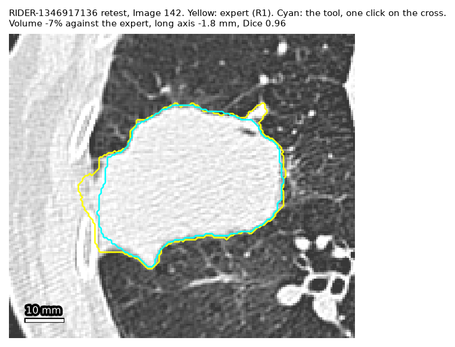
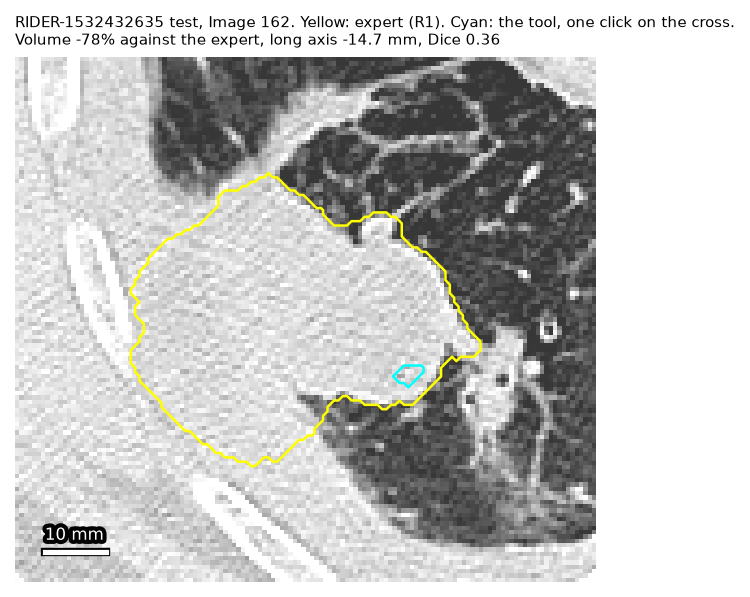
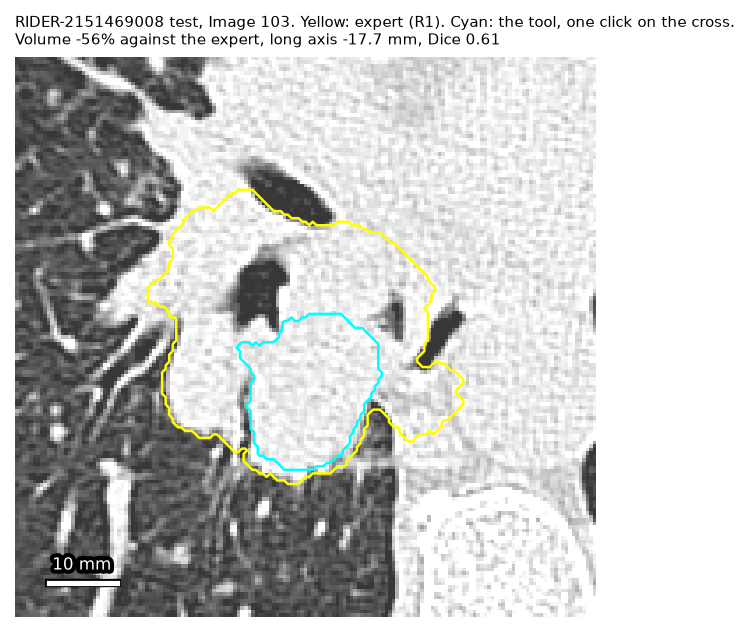
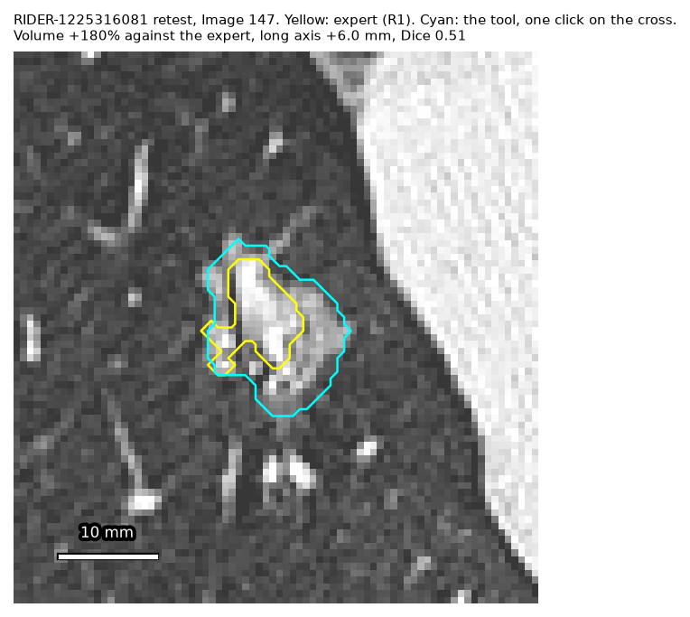
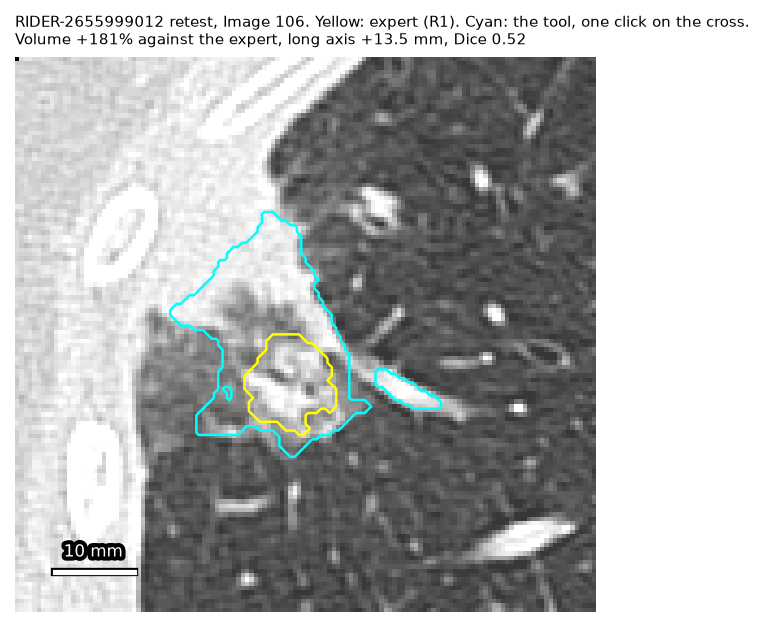

# Results

**Status: final; reviewed.** Since then: the practice-server re-check at `9768374`. Since then also: the two short extra measures (the Record step with the study record, and re-finding timed by hand), 2026-10-28 morning. Protocol: [protocol.md](protocol.md) (v1.14). The pilot's and the runs' own notes are not in this repository. Research use only: the tool is a research aid, and nothing here is a clinical claim.

## In one paragraph

Every time below is against **the lab's reported times** (20–34 min per scan with a volume, 5–9 min without one), not a stopwatch on its research fellow. **Main figure (b), measured plus modelled corrections:** with up to 5 corrections toward the expert outline, modelled by script from the operator's own click, the tool takes a median of **1.3 min per scan on this Mac** (slowest 2.7 min) and **2.3 min re-timed for a standard PC** (slowest 4.9 min), and 18 of 18 corrected outlines are inside the expert's own 9-in-10 range. **(b) is a lower bound on the tool's time, so its time saved is the most to expect, and it flatters quality:** the corrector is an oracle that knows where the error is, each correction costs only the time to click a point shown on screen (his median 11.7 s) plus the model, with no review after it, and steering toward R1 is then scored against R1. Steered toward the radiologists instead (R2, 16 runs), the time is 1.1 min (Mac) and 2.0 min (PC) per scan, but 7 of the 16 corrected outlines are outside R1's 9-in-10 range, because the radiologists draw smaller. **Floor (a), measured only:** one click and no corrections takes 44 s per scan (28–64 s), but 13 of the 18 one-click outlines are outside the expert's typical variation and 8 are failures (outside his 9-in-10 range), so (a) is not a saving on its own. The 8 failures are both scans of 4 patients: two small tumours where the tool took in too much, two large ones touching other tissue where it took in too little. N is small: 9 RIDER patients, one operator who is not a radiologist and clicked on a cross at the expert's centre (finding the tumour is not timed), one Mac. The tool's volume moved 6% between a patient's two same-day scans, against 18% for the expert, but with both clicks at the expert's centre, on volume only (the axes are not steadier on every patient), and on 4 patients it repeats the same error. Re-finding by script put the mark within 1 cm in 26 of 28 same-day pairs.

## Headline

| | Result: median (IQR; range) | N | Source |
|---|---|---|---|
| **(b) per scan, Mac**, failures left out (none at the corrector's stop) | 78 s (51–113 s; 33–164 s) | 18 | `eval/runs/projection.csv` |
| **(b) per scan, standard PC** (19.8 s per click, projected) | 137 s (77–221 s; 50–293 s) | 18 | same |
| (b) per scan, small PC (44.6 s per click, projected) | 221 s (102–370 s; 75–466 s) | 18 | same |
| (a) floor, per scan, Mac, all runs / failures left out | 44 s (38–55 s; 28–64 s) / 39 s (10 runs; 28–61 s) | 18 / 10 | same |
| The lab's research fellow, per scan (his reported times) | 20–34 min with volume; 5–9 min without | | the lab's report |
| **(a) one click: Dice against the expert (R1) / the radiologists (R2)** | 0.69 (0.58–0.84) / 0.75 (0.58–0.93) | 18 / 16 | `eval/runs/scores.csv` |
| (a) within the expert's typical variation (17.1%, 2.7 mm) / his 9-in-10 range (45.3%, 9.2 mm) | 5 / 10 of 18 (so 8 failures) | 18 | `eval/runs/q3c_summary.csv` |
| **(b) corrected toward R1:** reach his typical variation; corrections | 15 of 18; median 2 (at most 5 used; 3 not within 5) | 18 | same |
| (b) at the corrector's stop: Dice R1 / R2; inside the 9-in-10 range (steered and scored against R1, so flattered) | 0.84 / 0.83; 18 of 18 | 18 | same |
| (b) corrected toward R2 instead: reach the radiologists' typical variation; inside R1's 9-in-10 range; per scan Mac / PC | 14 of 16; 9 of 16; 67 s / 120 s | 16 | `eval/runs/q3c_summary.csv`, `eval/runs/projection_r2.csv` |
| **The lab's own bar, a sensitivity check** (its research fellow's re-measures: about 10% in volume, 2 mm on the axes): one click / corrected toward R1 until within it | 3 of 18 / 13 of 18 (median 2 corrections; 5 not within 5); per scan then 2.9 min PC, 1.5 min Mac | 18 | `eval/runs/q3c_summary.csv`, `eval/runs/projection_lab_bar.csv` |
| Yardsticks for Dice | radiologist against radiologist 0.88; R1 against one radiologist 0.77 | | protocol §Quality (S3c) |
| **Repeatability** (first scan against repeat): volume change, tool / expert | 6.1% / 17.9% (tool steadier on 9 of 9) | 9 patients | `eval/runs/q2.csv` |
| **Re-finding by script:** mark within 10 mm of the tumour's centre (same-day pairs, flattering on RIDER) | 26 of 28 (both misses inside the tumour) | 28 pairs | `eval/runs/f_summary.csv` |

## How time saved was measured

- **Baseline:** the lab's own reported times (its research fellow's), not a stopwatch: axes 2–4 min per nodule, volume 15–25 min per tumour, record 3–5 min per scan; his mid values, used in the projection, are 3, 20 and 4 min. Every comparison is "against the lab's reported times". Published expert times sit next to his ([manual-times-references.md](manual-times-references.md)).
- **The tool's time, measured (a):** the operator, who is not a radiologist, timed 18 runs with a stopwatch (`eval/stopwatch.py`), in two sittings on 2026-10-27 (9 first scans 15:53–16:04, 9 repeat scans 20:37–20:49, in the protocol's order), on the frozen commit `7a56526`, after about 10 minutes of practice on the development cases. Each run: open the scan at the hint image, one click on a cross at the expert's centre voxel (shown in a picture next to the tool), the wait, one pass through every slice of the outline, a look at the axes, then Record, Copy row, paste into a spreadsheet and Save screenshot. He made no judgement and no corrections (the protocol's amendments): his clicks would measure him, not the tool. Finding the tumour is not timed: the cross shows where it is. His clicks landed a median of 1.7 mm from the cross (at most 3.8 mm), all inside the expert outline.
- **Corrections, modelled (b):** a script replays his click through the engine and corrects toward the expert's outline, each time at the deepest point of the largest error, until within that expert's own typical variation, up to 5 (`eval/replay.py`). Each correction costs his own placement time for that run (median 11.7 s, from the hint image to the click) plus the model's time. Labelled: an efficient corrector steered by the expert; a real expert decides when to stop and may click more or less. It is an oracle and a lower bound on time: it knows where the error is, each correction costs only the time to click a point shown on screen, and there is no review after a correction. Both arms are timed: steered by R1 (`eval/runs/projection.csv`, 18 runs) and by R2 (`eval/runs/projection_r2.csv`, 16 runs; timed case 2 has no radiologist outline).
- **Failures are not time saved** (protocol §Timing): a run whose outline is outside R1's 9-in-10 range is left out of the "failures left out" rows, but counts in the rule below.
- **The rule:** a step's saving is "clear" if the slowest tool time × 4 is still under the lab's low end (his time halved, ours doubled). It is our rule, fixed before timing, not the lab's.
- **The lab's computer** has no graphics card. Every run is re-timed with S7's 19.8 s per click (standard PC, 4 vCPU) and 44.6 s (small PC, 2 vCPU): a projection.

## Time, measured

### Per run (`eval/run_table.py` on `eval/runs/scores.csv`; seconds)

PC: re-timed at 19.8 s per click. Size: the protocol's strata (S, M, L). Tags: the fixed rule of `eval/hard_cases.py`.

| Run | Scan | Size, tags | Open | Outline | Axes | Record | Per tumour | Per tumour, PC | Click from cross (mm) | Dice R1 | Dice R2 | Volume vs R1 | Long axis vs R1 (mm) | Notes |
|---|---|---|---|---|---|---|---|---|---|---|---|---|---|---|
| 1 | RIDER-2655999012 test | S, irregular | 23.5 | 16.2 | 4.4 | 13.9 | 34.6 | 51.7 | 2.8 | 0.653 | 0.356 | +95% | +2.2 | **failure** |
| 2 | RIDER-2357766186 test | M, irregular | 5.0 | 32.8 | 1.5 | 21.2 | 55.5 | 73.5 | 0.8 | 0.712 | – | -11% | -2.6 | +5.9 s screenshot |
| 3 | RIDER-2151469008 test | L, irregular, touching | 6.4 | 25.6 | 1.2 | 17.9 | 44.6 | 62.7 | 2.0 | 0.614 | 0.859 | -56% | -17.7 | +5.9 s screenshot; **failure** |
| 4 | RIDER-1867199702 test | S | 2.3 | 18.2 | 0.6 | 6.5 | 25.3 | 43.3 | 0.6 | 0.822 | 0.862 | -29% | -4.1 | phase split unreliable; +5.9 s screenshot |
| 5 | RIDER-1825099523 test | M | 2.3 | 19.9 | 0.7 | 17.8 | 38.4 | 56.3 | 1.4 | 0.882 | 0.937 | -21% | -3.2 | +5.9 s screenshot |
| 6 | RIDER-1532432635 test | L, irregular, touching | 1.2 | 40.2 | 1.1 | 21.5 | 62.8 | 117.9 | 2.2 | 0.361 | 0.591 | -78% | -14.7 | Start over; +5.9 s screenshot; **failure** |
| 7 | RIDER-1225316081 test | S | 7.2 | 21.6 | 0.4 | 16.3 | 38.3 | 56.3 | 2.2 | 0.602 | 0.592 | +123% | +7.3 | +5.9 s screenshot; **failure** |
| 8 | RIDER-3160137230 test | M | 8.6 | 28.7 | 0.6 | 15.6 | 44.9 | 62.9 | 1.7 | 0.694 | 0.6 | -3% | -0.6 | +5.9 s screenshot |
| 9 | RIDER-1346917136 test | L | 1.5 | 18.8 | 0.3 | 17.4 | 36.4 | 54.4 | 3.0 | 0.938 | 0.946 | -10% | -1.4 | +5.9 s screenshot |
| 1 | RIDER-2655999012 retest | S, irregular | 17.8 | 29.2 | 0.4 | 14.7 | 44.4 | 61.4 | 0.5 | 0.521 | 0.314 | +181% | +13.5 | **failure** |
| 2 | RIDER-2357766186 retest | M, irregular | 12.5 | 20.3 | 1.5 | 14.2 | 36.0 | 54.0 | 3.1 | 0.677 | – | -33% | -5.5 | phase split unreliable |
| 3 | RIDER-2151469008 retest | L, irregular, touching | 11.7 | 18.0 | 0.6 | 11.6 | 30.2 | 48.1 | 3.8 | 0.683 | 0.91 | -48% | -14.7 | **failure** |
| 4 | RIDER-1867199702 retest | S | 7.0 | 18.7 | 0.9 | 11.5 | 31.2 | 49.0 | 0.7 | 0.828 | 0.92 | -22% | -3.2 |  |
| 5 | RIDER-1825099523 retest | M | 15.5 | 21.4 | 0.5 | 12.0 | 34.0 | 51.9 | 0.4 | 0.897 | 0.937 | -18% | -8.0 |  |
| 6 | RIDER-1532432635 retest | L, irregular, touching | 12.7 | 18.6 | 0.9 | 10.5 | 30.0 | 48.1 | 0.9 | 0.514 | 0.575 | -65% | -3.4 | **failure** |
| 7 | RIDER-1225316081 retest | S | 1.9 | 18.1 | 0.8 | 11.9 | 30.8 | 48.9 | 1.7 | 0.514 | 0.542 | +180% | +6.0 | **failure** |
| 8 | RIDER-3160137230 retest | M | 1.3 | 20.3 | 0.8 | 10.2 | 31.3 | 48.9 | 0.7 | 0.713 | 0.646 | +6% | -1.9 |  |
| 9 | RIDER-1346917136 retest | L | 12.7 | 14.2 | 0.2 | 8.7 | 23.1 | 41.0 | 2.3 | 0.961 | 0.953 | -7% | -1.8 |  |

### Per step, against the lab's step and the published time (`eval/project.py` → `eval/runs/projection.csv`)

Median (slowest), seconds, 18 runs. The tool gives axes only from its outline, so the axes step is the outline and axes phases together. Verdict by the rule: clear if slowest × 4 is under the lab's low end.

| Step | The lab | Published | (a) Mac | (a) PC | (a) small PC | (b) Mac | (b) PC | (b) small PC |
|---|---|---|---|---|---|---|---|---|
| Volume, per tumour | 15–25 min | 2–3 min (small, with a tool) to 10–22 min | 20 (40): clear | 38 (95): clear | 63 (170): clear | 51 (140): clear | 115 (269): **not clear** | 189 (443): **not clear** |
| Axes, per nodule | 2–4 min | about 40 s | 21 (41): **not clear** | 39 (96): **not clear** | 63 (171): **not clear** | 52 (141): **not clear** | 115 (270): **not clear** | 189 (444): **not clear** |
| Record, per scan | 3–5 min | none found | 14 (22): clear | 14 (22): clear | 14 (22): clear | same | same | same |

Quartiles for every cell: `eval/runs/projection.csv`.

- **The axes step is not clear anywhere.** Its slowest one-click run (41.3 s) times 4 is 165 s, over the lab's low end of 2 min. Against the published 40 s: with one click (a) about the same or faster (21 s on the Mac, 39 s on a standard PC); with the corrections (b) slower (52 s on the Mac, 115 s on a standard PC).
- **The volume step is not clear with corrections on either PC.** Without corrections it is clear on every machine, but most one-click outlines are not good enough (Quality).
- **Breakdown:** the model's time was a median of 1.8 s per click in the timed runs: one first click per newly opened scan. The server check's 1.19 s is a median over first clicks and corrections on scans already open; we did not separate the two. The first click after an engine start took 2.6 and 2.7 s (the first run of each sitting): the cold start. The outline phase (median 20 s) holds the click, the wait and the review pass. The record phase (median 14 s) holds Record, Copy row, the paste and Save screenshot.
- **Per hard tag** (one click, per tumour): hard tumours 40 s at the median (8 scans), the others 33 s (10). By size: small 33 s, medium 37 s, large 33 s (6 each).
- **Flagged runs, kept:** on two runs (first scan of RIDER-1867199702, repeat scan of RIDER-2357766186) the stopwatch's "outline" Enter came before the click, so their phase split is unreliable; their totals stand. Without them, every (a) Mac per-step median and slowest time above is the same to 0.2 s (16 runs). One run (first scan of RIDER-1532432635) had a correction click, Undo and Start over after a click off the cross, against the protocol's "no + or −"; its seconds stay in it, and its accepted outline and replayed click are from the second first click (protocol v1.13).
- **Screenshot rule (ours, set after sitting 1, before sitting 2 and before any scoring):** on sitting 1 he pressed Save screenshot on run 1 only. Runs 2–9 get the larger of 1 s and sitting 2's median Copy row → Save screenshot time, 5.9 s (`eval/score.py`, `screenshot_added_s`), and count as complete.
- **Timed case 7** (RIDER-1225316081) was exposed before timing as a research page's worked example (protocol §Prior exposure). The operator had not opened any timed patient's scan, cross picture or outline (his answer before sitting 1); whether he remembered that page's example was not asked. Without case 7: one-click time per tumour 35 s, Dice 0.70 against R1, 6 failures in 16 runs.
- **Our target** was 1–3 min to check and correct a nodule, and about 45% (35–55%) of the lab's research fellow's whole hands-on week saved. (b) per tumour is 66 s on the Mac and 129 s on a standard PC at the median, inside the first target; 205 s on a small PC, above it. For the second, see the whole-week line under Projection: 31% to 47% on a standard PC.
- **Not measured here:** the setup tests (§Setup tests) have not been run.

## Quality

The same code (`eval/measure.py`) measures every outline. The tool's own numbers agree with our recomputation within 0.0 mL in volume and 0.5 mm in axes on all 18 (`check_*` in `eval/runs/scores.csv`). No outline touched the edge of the region the model can draw in: the tool's warning fired 0 times and our own check found 0 (18 runs). Two references, side by side: R1, the RIDER-LungCT-Seg expert outline, and R2, the five QIBA radiologists (median over readers; timed case 2 has none). R1 is bigger than the radiologists' in 237 of 280 pairs, and neither is the truth.

### Q1: each run against the experts (`eval/runs/scores.csv`, `eval/runs/q3c_summary.csv`)

| | Dice vs R1 | Volume change vs R1 | Long axis error vs R1 | Dice vs R2 |
|---|---|---|---|---|
| (a) One click on the cross, 18 runs | 0.69 (0.58–0.84) | 36.9% (11.3–81.6%) | 3.8 mm (2.1–9.4 mm) | 0.75 (0.58–0.93), 16 runs |
| (b) Corrected toward R1, at the stop | 0.84 | 9.1% | | 0.83 |
| (b) Corrected toward R2, at the stop, 16 runs | 0.81 | 24.1% | | 0.90 |

Short axis error, one click: 4.4 mm (1.8–8.3 mm). The yardsticks: R1 against itself on the repeat scan, median 17.1% and 2.7 mm (90th percentile 45.3% and 9.2 mm); radiologist against radiologist on the same scan, 15.0% and 2.0 mm (`eval/runs/yardsticks.csv`); Dice radiologist against radiologist 0.88, R1 against one radiologist 0.77 (S3c, protocol §Quality). The tool is set against the radiologists as their median, not reader by reader.

- **Corrections to the steering reference's own bar** (from his click, stopping at the bar): steered by R1, 15 of 18 reach it, median 2 corrections, 3 not within 5; steered by R2, 14 of 16, median 2 (at most 3 used), 2 not within 5. Steering flatters the score against the same reference, so the other reference's column is the fairer one: 0.83 steered by R1, 0.81 steered by R2. **Time of the R2 arm (b):** per scan 67 s on the Mac (36–175 s) and 120 s on a standard PC (54–278 s), 16 runs; volume step clear on the Mac, not clear on the PCs; axes not clear (`eval/runs/projection_r2.csv`).
- **Which reference matches the lab's style:** the lab's research fellow: "I always include the spikes and the hazy ground-glass component within the nodule volume" (2026-10-28). That is the larger style, R1's rather than the radiologists' (R2 is smaller in 237 of 280 pairs), so the R1-steered results (15 of 18 within the typical change, 18 of 18 within the 9-in-10 range) are the ones closer to the lab's own outline style. Our inference, not his words; R2 stays reported.
- **The lab's own bar, a sensitivity check:** its research fellow said his re-measures differ by "roughly 10%" in volume and "a couple of millimetres" on the axes, tighter than R1's measured repeat change (17.1%, 2.7 mm), which he proposed we use. At 10% and 2 mm against R1: 3 of 18 one-click outlines are within it; corrected toward R1 until within it, 13 of 18 reach it (median 2 corrections), 5 not within 5. Steered toward R2 and scored against R2: 2 of 16 at one click, 11 of 16 corrected. Correcting to this bar costs more: per scan 2.9 min on a standard PC and 1.5 min on the Mac at the median, the slowest unchanged (the cap of 5) (`eval/runs/projection_lab_bar.csv`).
- **Failures (a):** 8 of 18 runs are outside R1's own 90th percentile, both scans of 4 patients (What fails). At the corrector's stop, 0 of 18 steered by R1 are; steered by R2, 7 of 16 are outside R1's range, because the radiologists' outlines are smaller than R1's.
- **Hard tumours** (irregular or touching other tissue; 4 patients, 8 scans): one-click Dice 0.63 against R1 and 0.58 against R2, 6 of the 8 failures; the other 10 scans: 0.83 and 0.89, 2 failures.
- **Small tumours** (stratum S; 3 patients, 6 scans): one-click Dice 0.63 against R1 and 0.57 against R2, volume change 70.5%, 4 failures. Medium: 0 failures; large: 4.

### Q2: repeatability, first scan against repeat (`eval/q2.py` → `eval/runs/q2.csv`)

The tool's volume changed by a median of **6.1%** from first scan to repeat (long axis 1.6 mm, short axis 0.9 mm); the expert's own outlines changed by **17.9%** (3.6 mm and 2.0 mm) on the same 9 patients. On volume the tool is steadier on all 9, and none of its changes is above R1's repeat 90th percentile. On the axes it is not steadier on every patient: the long axis changes more than the expert's on RIDER-1225316081 (1.6 against 0.3 mm) and RIDER-3160137230 (1.4 against 0.1 mm), and the short axis on RIDER-2655999012 (12.8 against 1.0 mm) and RIDER-3160137230 (1.7 against 0.6 mm). **What this does and does not show:** the steadiness comes from the same click on a deterministic engine: both clicks were on the expert's centre on each scan, and the engine gives the same outline for the same click, so this is the tool's best case; a click 3–5 mm away moves the volume by a median of 8.1% on these patients (Q3b). Steady is not right: on the 4 failure patients the tool repeats the same error on both scans. Q2 for (b) is not computed: the corrections steer each scan toward that scan's own expert outline, so their repeat change would measure the expert's.

### Q3 and Q3b on the 9 timed patients, by script (secondary; `eval/runs/q3_summary_timed.csv`)

The same method as the held-out run below: the first click at the deepest point of R1, not at his click, then up to 5 corrections steered by one reference. So its numbers differ a little from (a) and (b), which start from his click. First click: Dice 0.66 against R1 and 0.72 against R2, volume change 43%. After 5 corrections toward R1: 0.86 and 0.80; 6 of 18 scans not within R1's typical variation. **Where the click lands:** from the cross and 3 and 5 mm off it (159 first clicks), two such clicks on the same scan differ by a median of 8.1% in volume; 26.1% of such pairs differ by more than the expert's typical repeat change, and 9.0% by more than his 9-in-10 range. Of the 141 clicks 3–5 mm off the cross, 22 gave an outline over twice R1's volume (21 of them on small tumours), and 27 under half of it (all on irregular tumours, 24 of them also touching other tissue); of the 18 scripted clicks on the cross itself, 2 and 3. These 9 patients are harder than the held-out 16: 4 of 9 are tagged irregular, against 4 of 16.

### Q3 and Q3b: the tool by script on the 16 held-out patients (done 2026-10-26; secondary)

No person in the loop: the first click at the deepest point of R1's outline, then corrections each at the deepest point of the largest remaining error, steered by one reference. Engine at commit `75f2797`. Re-checked at the frozen commit `7a56526` on 5 of the patients (10 scans): all 320 rows identical (`eval/q3_compare.py`). 16 patients, 32 scans. Totals from `eval/runs/q3_summary.csv` (`eval/q3.py`, `eval/q3_summary.py`).

| | Dice vs R1 | Volume change vs R1 | Dice vs R2 | Volume change vs R2 |
|---|---|---|---|---|
| First click | 0.81 | 22.9% | 0.81 | 17.4% |
| Steered by R1, after 2 corrections | 0.86 | 7.3% | 0.78 | 27.0% |
| Steered by R1, after 5 corrections | 0.88 | 2.9% | 0.79 | 31.6% |
| Steered by R2, after 5 corrections | 0.78 | 29.0% | 0.90 | 8.6% |

- **Corrections to the steering expert's own bar** (median): 1 when steered by R1; 0 when steered by R2. Not reached within 5 corrections: 5 of 32 scans (R1-steered) and 10 of 32 (R2-steered). Not within the failure line after 5 corrections: 2 of 32.
- **Irregular tumours** (4 patients): first click Dice 0.62 against R1 and 0.48 against R2, against 0.81 overall.
- **Where the click lands:** a one-pixel shift moves the first outline little (median spread 3.8% in volume, 1.4 mm in long axis). A click 3–5 mm from the centre moves it more: two such clicks differ by a median of 6.3% in volume; 18.8% of pairs differ by more than the expert's typical repeat change, 8.4% by more than the failure line. Of 235 such off-centre first clicks, 15 gave an outline over twice R1's volume, all on small tumours; 21 gave one under half of it, 19 of them on tumours that touch other tissue. Of the 32 clicks on the centre itself, 2 and 2. On one held-out tumour, a click at its centre gave an almost empty outline (about 1% of R1's volume).

### F: re-finding on the repeat scan, by script (all 28 pairs; `eval/f_accuracy.py` → `eval/runs/f_summary.csv`)

The tool's own matching code (`lung_engine.followup`, at `7a56526`, unchanged on main) maps a click on the first scan, at R1's voxel nearest its centre, to the repeat scan. A hit is within 10 mm of the repeat R1's centre (the lab's research fellow).

| Pairs | Hits within 10 mm | Mark inside the tumour | Distance: median, maximum | Alignment time per pair (this Mac's CPU) |
|---|---|---|---|---|
| All 28 | 26 | 25 | 3.3 mm, 15.3 mm | 12.0 s |
| Development (3) | 3 | 3 | 5.1 mm, 5.9 mm | 22.5 s |
| Held out (16) | 15 | 14 | 2.4 mm, 15.3 mm | 11.4 s |
| Timed (9) | 8 | 8 | 4.2 mm, 10.5 mm | 9.6 s |

- **Both misses land inside the tumour** (15.3 mm on a large held-out tumour that touches other tissue; 10.5 mm on a timed one), so the view still opens on it.
- **Three hits fall beside the tumour** (3.2 to 9.5 mm from its centre): within the lab's 1 cm, but not on it.
- **Flattering on RIDER:** large tumours, one per scan, scans from the same day; the 3 development pairs are included. "Nearer to it than to any other nodule" is not tested. The re-find time by hand: §The two extra measures.

### Practice server: the same outlines as the Mac? (done 2026-10-27)

`eval/server_check.py`, rule fixed before the data: every outline Dice ≥ 0.99 against the Mac's and a volume within 1%. **Baseline:** the Mac engine against itself (frozen `7a56526`, the 6 development scans, three runs of the same clicks) gave 113 of 113 outlines identical, voxel for voxel, at 1.17 s per click (`eval/runs/server_check_mac_vs_mac.csv`).

**The check (12:39–12:50):** server 1 (Hugging Face, T4 graphics card) against this Mac, both at commit `aa0126c`, the same 113 click sequences on the 6 development scans. The requests ran inside the operator's own sign-in in our test browser; the token never left it. Rows: `eval/runs/server_check_aa0126c.csv`.

| | Result |
|---|---|
| **Verdict by the rule** | **The same tool** |
| Dice, server against Mac | lowest 0.9977, median 0.9998 |
| Volume difference | largest 0.32%, median 0.02% |
| Long and short axis difference | largest 0.17 mm and 0.18 mm |
| Outlines identical voxel for voxel | 9 of 113 (a median of 6 voxels differ; at most 171, on an 18.4 mL outline) |
| Displayed numbers identical | 61 of 113: the others differ in the last digit (for example 6.90 against 6.91 mL) |
| Server against itself (two runs) | identical |
| Seconds per click | Mac 1.19, T4 0.35 |

**Since the check,** both servers moved to commit `9768374` (2026-10-27 night). Its outlining and measuring code (`nni.py`, `outline.py`, `measure.py`) is identical to `aa0126c` (git diff); the changes are in the routes (scan codes), the study index, the finder's candidates and reading study dates. So the verdict carries over by the code, not by a new measurement.

**Re-checked on 2026-10-28 (23:59–00:09), at `9768374`:** server 2 against this Mac, both at `9768374`, the same 113 click sequences, after the 28 practice patients were mounted (the operator's sign-in again in our test browser; `eval/runs/server_check_9768374.csv`). **The same tool by the rule:** Dice at least 0.9977 (median 0.9998), volume within 0.35% (median 0.02%), server identical between its own two runs; 8 of 113 outlines identical voxel for voxel, 64 of 113 with identical displayed numbers; 1.31 s per click on the Mac, 0.35 s on the T4. One thing the rule does not cover: on 2 of 113 outlines (both after corrections) the long axis differs by 2.2 and 2.8 mm, although the outlines agree to Dice 0.998 and 0.9995. A few edge voxels changed which two points lie furthest apart; 2.8 mm is just over the expert's typical repeat change in long axis (2.7 mm). **At submission (2026-10-28):** the live page is `9678a29` and Baseline v0.1.2 is built from it (release commit `15454ad`); the practice servers run `f5525b2`. Against the re-checked `9768374`, every engine since (`8f6e4ca`, `e8231ce`, `f5525b2`, `5a0898a`, `9678a29`) keeps `nni.py` and `measure.py` identical and changes `outline.py` only in the paint tool's Snap threshold (−500 → −750 HU); the other changes are the finder, gzip and a warm-up on the servers, and the default practice list (git diff). So the model's outlines, the ones checked, are unchanged.

**The servers' warm-up (`f5525b2`):** Snap at −750 HU keeps the hazy ground glass, the lab's convention; `scans.py` adds a warm-up read of every practice scan at start. **Opening a scan on a fresh server, measured by the tool's developer on server 2, not re-measured by us:** before the warm-up 30–35 s; with it 0.3–6.6 s, and 9 s after a restart for the tutorial case. **A known limit:** the first image of a visit's first scan comes about 6 s after the scan opens (later scans in the same visit 0.3–1.5 s), because the page asks for 5 slices at once and they share the download at the start of a visit. Find on the server took 20–23 s.

### Spiculated nodules (S9, our labelled feasibility test, not these results)

10 spiculated nodules from LIDC-annot-NLST501 (unseen by the model), scored by a rule agreed before the data (its notes are not in this repository). We recomputed its headline numbers from its files.

## The two extra measures (2026-10-28 morning; labelled, not the 18 timed runs)

Both on the 3 development patients, which were his practice cases, after both sittings.

### The Record step with the study record (`eval/record_step.py` → `eval/runs/record_step.csv`)

On the live v0.1.1 page (`8f6e4ca`) with a clean local engine at the same commit (protocol v1.14), 6 records, one per development scan. The record step is Record, wait until the green box says saved, Save screenshot, with no Copy row and no spreadsheet ("with the record"), against the timed runs' Record, Copy row, paste, Save screenshot ("with the paste").

| | With the record (6) | With the paste | The lab |
|---|---|---|---|
| Record phase, stopwatch: median (IQR; range) | 9.9 s (8.5–19.1 s; 8.3–20.5 s) | 14.1 s (11.2–17.5 s; 6.5–21.5 s), 18 runs | 3–5 min per scan |
| Record → Save screenshot, from the tool's log | 2.7 s (1.6–4.9 s; 1.5–10.4 s) | 6.8 s (5.3–8.2 s; 4.8–13.8 s), sitting 2's 9 runs | |

- **About 4 s saved per scan** at the median: the study record removes the paste, but the record step was already seconds against the lab's minutes. By the rule, clear either way (slowest 20.5 s × 4 = 82 s, under 3 min).
- **Not a paired result:** different cases (development against timed), a later sitting, practised cases. In all 6 runs the stopwatch's "outline" Enter came before the click, so the outline and axes phases are unreliable; the record phase is not affected (every Record and screenshot falls inside it). Our engine checkout first had no built web page, so the hosted Patients panel failed to load; the page was built and the engine restarted before any run.
- **The rows** are practice rows on Base44; they belong on our list of test rows, to delete before inviting other users.

### Re-finding timed by hand (F; `eval/f_timing.py` → `eval/runs/f_timing.csv`)

On the first version with F (`8e86cf6`), the tool's own page, timed from its log: from opening the repeat scan to Measure here at the proposed position, less that click's model time. He made no judgement: he pressed Measure here wherever the ring landed. All proposals were accepted; none said "Find it by hand".

| Run | Time | Find's alignment (this Mac's CPU) |
|---|---|---|
| Patient 1, the untimed try (the first Find for that pair) | 31.2 s | 7.4 s |
| Patient 2 (first Find) | 14.5 s | 9.2 s |
| Patient 3 (first Find) | 19.8 s | 8.8 s |
| Patient 1, the timed redo (the alignment was already cached from the try) | 4.5 s | 0.0 s |

- **Against the lab's about 10 min per nodule and the published 1.6 min:** 15–20 s on a first Find, 4.5 s with the alignment cached. By the rule (2.5 min), clear even with the try counted (31.2 s × 4 = 125 s).
- **The redo is flattering** because the engine kept the try's alignment; on a first Find the alignment takes 7–9 s on this Mac's CPU, more on a slower computer.
- **Labels:** N = 3; a lower bound, because the lab's research fellow also checks that the mark points to the right nodule, which is not timed; flattering on RIDER (large tumours, one per scan, same-day scans; the development patients were his practice cases). Whether F lands on the tumour is the scripted count above (26 of 28).

## Projection, kept apart

The lab's research fellow's week (12–15 scans, 1–2 nodules each), with each step's time replaced by the tool's median, and in brackets by its slowest run, against the lab's mid times (`eval/project.py`). Not measured: it multiplies measured step times by his reported workload. Re-finding is left out on both sides, and so is opening the scan.

| Hours a week on the measuring steps (axes, volume, record) | The lab | (a) Mac | (a) PC | (b) Mac | (b) PC | (b) small PC |
|---|---|---|---|---|---|---|
| Volume on 1 tumour in 5, as today | 3.3 | 0.17 (0.31) | 0.27 (0.62) | 0.35 (0.88) | 0.70 (1.60) | 1.12 (2.58) |
| Volume on every tumour, as the lab wants | 8.7 | 0.17 (0.31) | 0.27 (0.62) | 0.35 (0.88) | 0.70 (1.60) | 1.12 (2.58) |

The tool's hours are the same in both rows because it always gives a volume. The main figure is (b), a lower bound on the tool's time, so the savings below are the most to expect: on a standard PC, **78.5% of the measuring steps** as today (3.3 h → 0.7 h a week), and 91.9% with a volume on every tumour (8.7 h → 0.7 h). That is of the measuring steps only, not of the research fellow's whole week; (a) is the floor and is not a saving on its own (Quality).

**Like for like with our target of 45% (35–55%) of the whole hands-on week** (`whole week (target basis)` rows): the target's week, from the lab's figures (midpoints), is finding about 200 min, untouched by the tool; the measuring steps 196 min as today (this script's figure; the target's own arithmetic has 194); re-finding about 105 min; 501 min in all. With the tool, (b) on a standard PC: 200 + 42 min of measuring + re-finding. If re-finding stays at 105 min, the week is 347 min, **30.7% saved**; if it takes the target's assumed 26 min, 268 min, **46.5% saved**. Both are the most to expect, since (b) is a lower bound on the tool's time. Re-finding by hand took 15–20 s per nodule on a first Find (N = 3, a lower bound, flattering on RIDER), well under the target's assumed 26 min a week, so the 46.5% end is the closer one, with the same caveats. On the Mac: 35.0% to 50.7%; on a small PC: 25.7% to 41.5%. Low and high ends: `eval/runs/projection.csv`.

## What works

- **Speed, measured (a):** every run took under 65 s from opening the scan to the saved row, the outline phase under 41 s. With the modelled corrections (b, not measured), a median of 1.3 min per scan on the Mac and 2.3 min on a standard PC.
- **Volume and record steps are clear by our rule** without corrections on every machine, and the record step everywhere; the volume step with corrections on the Mac.
- **Separate, regular tumours** (no hard tag, 10 scans): one-click Dice 0.83 against R1 and 0.89 against the radiologists; the medium-size group has no failures. The run with the highest Dice against R1, as an example:

- **Corrections close the gap (b, modelled, a lower bound, steered and scored against R1):** 2 at the median bring 15 of 18 within the expert's typical variation, and all 18 inside his 9-in-10 range. Steered toward the radiologists, 14 of 16 reach their typical variation.
- **The numbers the tool reports are the numbers it draws:** our recomputation agrees on all 18.
- **Re-finding by script:** 26 of 28 marks within 1 cm on same-day pairs, on the CPU (flattering on RIDER; "nearer than any other nodule" not tested).

## What fails

Each failure below is one click on the cross, as timed; both scans of each patient fail the same way. The likely causes are our guesses from the images, not a radiologist's reading.

1. **A large tumour that touches the chest wall (RIDER-1532432635, irregular and touching):** the outline stays in a small part of the tumour, −78% and −65% in volume against R1, Dice 0.36 and 0.51; the radiologists' outline is also much bigger (−57% against R2). Our guess: the tumour meets soft tissue of about the same density, and one click does not tell the model where it ends.

2. **A large irregular tumour touching other tissue (RIDER-2151469008):** −56% and −48% against R1 and 15–18 mm short in long axis, but close to the radiologists (Dice 0.86 and 0.91, −18% and −14% against R2). This one is a disagreement between the references as much as a tool error.

3. **Two small tumours (RIDER-2655999012, irregular; RIDER-1225316081):** the tool takes in the surrounding hazy area, +95% to +181% against R1, and +132% to +364% against the radiologists. The lab's research fellow has since answered (2026-10-28): "I always include the spikes and the hazy ground-glass component within the nodule volume". So on these two tumours the tool's larger outline may be closer to his style than R1's; not tested, and both references stay reported.

4. **Where the click lands matters on hard and small tumours:** on the timed patients, 22 of 141 clicks 3–5 mm off the centre gave over twice the expert's volume, and 27 under half (Q3b). The cross is the best case.
5. **A tumour next to an airway (development case RIDER-1286684383, first scan):** from the deepest point the first outline has Dice 0.24 against R1, 0.69 after two corrections and 0.80 after five (`eval/runs/q3-dev/`).
6. **"Not clear" by our time rule** for the axes step on every machine, and for the corrected volume step on both PCs (Time).

## Limitations and disclosures

- **The operator is not a radiologist and makes no judgement:** the lab's real check (judging every slice, deciding to correct) is not measured, and the review pass is a lower bound. Finding the tumour is not timed (the cross).
- **The modelled corrector is an oracle:** it knows where the error is and when to stop, each correction costs only a click on a point shown on screen, and nothing is reviewed after it, so (b) is a lower bound on time and, scored against the reference it steers toward, flatters quality. A real reader clicks more or less.
- **N:** 9 timed patients (18 runs), one operator, one Mac; 16 held-out patients for Q3; 28 pairs for F.
- **The cross is the expert's centre:** his click is the best case for quality and for repeatability (Q3b shows less exact clicks).
- **RIDER:** tumours larger than typical nodules, one per scan, repeat scans on the same day.
- **"The expert" is one outline style (R1);** the radiologists' outlines (R2) are smaller in 237 of 280 pairs. Neither is the truth. The lab's research fellow includes the spikes and the hazy ground glass (2026-10-28), the larger style, so R1 and the R1-steered results (15 of 18 within the typical change) are the closer guide for him: our inference, not his words. On spiculated nodules the model's first outline leaves the spikes out (S9: smaller in 9 of 10), so for his style it needs corrections there.
- **Three runs flagged** (two unreliable phase splits, one Start over), kept and reported; the screenshot time added to 8 runs by our rule, set after sitting 1, before sitting 2 and before any scoring. All in protocol v1.13.
- **Exposures, all before any timing** (protocol §Prior exposure): expert volumes in protocol versions 1.0–1.3; timed case 7 as a worked example on a research page; DICOM header values of case 7 and one held-out patient, read by one of our coding agents. The spikes and the engine choice used these patients. After the timed runs, a dry run of the practice-server upload script counted and sized the CT files of one held-out and one timed patient, reading no content (protocol v1.13).
- **The held-out Q3 ran at `75f2797`**, and was re-checked at the frozen `7a56526` on 5 of the 16 patients (identical), not all 16.
- **The PC times are a projection** from S7's 19.8 s and 44.6 s per click.
- **On a practice server,** a visit's first image comes about 6 s after its first scan opens (the tool's developer's measurement); later scans in the visit open in 0.3–1.5 s.
- **The lab's times are recalled, not timed;** the published expert times are lower for the axes and re-finding.

## Traceability

Every number above comes from a script in `eval/` and a file named next to it. To reproduce the timed scoring, run `score.py`, `replay.py` (with and without `--offsets`), `q3.py --after-timed-runs`, `f_accuracy.py`, `q3_summary.py` and `project.py` in order (each script's first lines give its arguments); then `eval/q3c_summary.py`, `eval/q2.py`, `eval/run_table.py` and `eval/failure_picture.py`. The operator's stopwatch rows are in `eval/runs/timing.csv`. The run notes, and the tool's own log and outlines from the timed runs, are not in this repository (the scans are public RIDER data).
